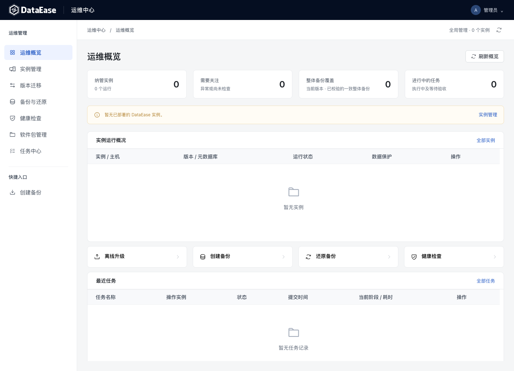

# DataEase 运维中心

管理 DataEase 实例的安装、升级、备份、还原和巡检，支持将 V2 迁入已有 V3，或在同一台服务器上新建 V3 后迁入。

## Docker 部署

推荐使用 **Docker Compose**。将 [docker-compose.yml](docker-compose.yml) 放到部署目录，使用 `docker compose` 插件启动。配置已在 Compose v2.40.3 验证，旧版 Python `docker-compose` v1 不适用。

首次启动前，在终端输入 8–256 个字符的管理员密码。

```bash
printf '请输入初始管理员密码 '
IFS= read -rs OPERATIONS_ADMIN_PASSWORD
printf '\n'
export OPERATIONS_ADMIN_PASSWORD
docker compose up -d
```

也可以执行以下命令，用同一镜像直接启动。

```bash
docker run -d --name dataease-migration \
  -p 127.0.0.1:8080:8080 \
  -e OPERATIONS_ADMIN_PASSWORD \
  -v dataease-migration-data:/opt/apps/data/operations \
  registry.cn-qingdao.aliyuncs.com/dataease/dataease-migration:v1.1
```

- 打开 [http://127.0.0.1:8080](http://127.0.0.1:8080)，使用 `admin` 和初始密码登录。已有数据卷沿用原密码。首次登录后可执行 `unset OPERATIONS_ADMIN_PASSWORD` 清除当前终端中的密码变量。
- 从内网访问时，在 Compose 的 `.env` 中设置 `OPERATIONS_HOST_ADDRESS` 为服务器内网 IP。可用 `OPERATIONS_HOST_PORT` 修改端口。
- SQLite、加密凭据、备份和软件包保存在 Docker 数据卷中。Compose 使用 `operations-data` 卷，`docker compose down` 保留数据，`down -v` 会删除数据卷。

## 主要功能

- **实例管理**。接入已有实例或登记空白服务器，按需离线安装、升级或卸载 DataEase。
- **备份与还原**。支持数据、资源和整体备份，可定时备份。符合条件的整体备份可用于异机重建，外部业务数据库需单独备份。
- **健康检查与任务**。检查应用、数据库和磁盘，在任务中心查看各阶段的进度、日志和结果。
- **软件包管理**。上传离线包、通过直链下载软件包，或从应用市场获取插件。校验入库后可重复使用。



## V2 迁移到 V3

迁移源要求 **V2.10.26 及以上的 V2**。自动迁移适用于受支持的单机 Docker Compose + MySQL 部署。

1. 在「版本迁移」选择已接入的 V2 和目标 V3。同机新建 V3 时，源端需为使用内置 MySQL、通过 SSH 接入的企业版实例，并准备匹配架构的 V3 企业版离线包。
2. 确认目标后，平台执行预检查，并校验源端和目标端的保护备份，再覆盖目标库和迁移范围内的资源。同机部署须使用独立目录、数据库和业务端口。
3. 目标 V3 先隔离运行。业务验收后可开放访问，按需恢复同步、定时报告和告警。

## 从源码运行

只安装 Docker 时，可在源码根目录执行 `docker build -t dataease-migration:v1.1 .`，设置 `OPERATIONS_IMAGE=dataease-migration:v1.1` 后用 Compose 启动。

直接运行 JAR 需要 JDK 17 或以上。自行构建还需要 Maven、Node.js 22.12 或以上和 npm。

```bash
mvn -B -ntp clean package
java -jar target/dataease-migration-1.1.jar
```

首次运行 JAR 可从运维服务本机的 localhost 页面初始化管理员。Maven 发行 ZIP 同时包含 JAR 和迁移插件。运行 JAR 时以包含 `plugins/` 的目录为工作目录，或用 `MIGRATION_PLUGINS_DIRECTORY` 指定插件目录。Docker 和 JAR 均通过内置 JDBC 驱动迁移 MySQL。
